# TrueAir: catching factories that fake their pollution data, built on AWS

Every air-quality decision in a city rests on a number someone chose to trust. An AQI alert, a school moving PE indoors, a notice to a polluting plant: there's a data point underneath each one. For India's most polluting industries, much of that data comes from the factories themselves.

Since February 2014, the Central Pollution Control Board (CPCB) has required **17 categories of highly polluting industries** to install online continuous emission monitoring systems (CEMS). These systems send readings to the central and state boards every 15 minutes, and by 2019, 4,251 industries had installed them ([Down To Earth, September 2019](https://www.downtoearth.org.in/amp/story/air/implementation-of-this-efficient-pollution-monitoring-system-caught-in-delays-66746)). The same report quotes an expert calling poor data quality "one of the biggest challenges for the success of CEMS in India".

The weak point is easy to miss: **the factory owns the monitor.**

For a hackathon in the Air track, I built **TrueAir**. It checks whether factories are telling the truth about their emissions, and it warns schools downwind when the air turns bad. This post explains how the dashboard works, how each detection layer works, how it runs on AWS, and where quantum computing helps and where it doesn't.

- **Live demo:** https://5ecvfcrz6g.ap-south-1.awsapprunner.com (it may be paused outside demo windows)
- **Code:** https://github.com/ANI-MAZING/True-Air


> **Key Takeaways**
> - TrueAir compares what each factory *reports* with what independent air stations and a satellite *measure*. It doesn't rely on the factory's numbers alone.
> - A signing chip in each monitor catches edited or replayed data on the very next reading. Physics checks and an inverse dispersion model catch subtler lies, like capped readings or a bypassed analyser, within 45 to 105 simulated minutes.
> - In 6 simulated runs, honest plants produced **zero false alarms** across 3,360 checks.
> - Quantum key distribution protects the links between pollution boards, not the factory monitors. In an honest benchmark, classical models beat my hybrid quantum model.
> - The app runs on AWS App Runner, stores every verdict in DynamoDB and sends throttled alerts through SNS. One CloudFormation template creates the table, topic, roles and service.

---

## What can go wrong with self-reported emissions data?

The documented problems are mostly about quality and access. Down To Earth's 2019 report describes uncalibrated analysers producing faulty data. In 2022, CPCB found that some state portals were missing historical data and some industries showed no real-time data at all ([Down To Earth, April 2022](https://www.downtoearth.org.in/pollution/industry-emissions-data-incomplete-inaccessible-on-rajasthan-chhattisgarh-websites-cpcb-82542)).

TrueAir goes one step further. It assumes some operators might *deliberately* cheat, and it's designed to catch five behaviours:

1. **Capping:** never report above the consent limit, whatever the real value is.
2. **Flatlining:** bypass the analyser and feed the data system a constant "clean" number.
3. **Replay:** re-send recordings from a clean day.
4. **Editing in transit:** shrink the values between the monitor and the regulator.
5. **Going dark:** lose connectivity exactly when emissions are high.

This is a threat model, not a claim about how often each one happens. It covers what a dishonest operator could do with the access they already have.

Cheating has a motive. Running pollution controls such as SO₂ scrubbers costs money. In TrueAir's simulation, every cheating behaviour also means the plant **runs dirty**, emitting almost twice its normal load. The tampering exists to hide that.

---

## How does the TrueAir dashboard work?

The dashboard is a single-page console built for a pollution control board analyst. It refreshes every 2 seconds. Each refresh is 15 minutes of simulated time, so a full day passes in about 3 minutes.

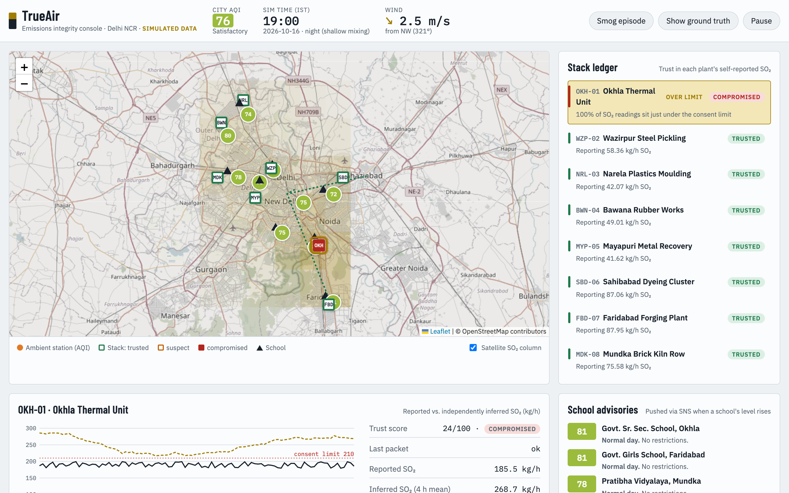
*A normal day. City AQI is Satisfactory. Seven plants are trusted, and one (Okhla) is flagged compromised and over limit.*

**Top bar**
- **City AQI:** the average across the ambient stations, coloured by CPCB category.
- **Sim time:** at night the air near the ground mixes less, so pollution builds up.
- **Wind:** speed and direction. The arrow shows where pollution is blowing, which drives everything else.
- **Demo controls:**
  - **Smog episode** raises regional background pollution, like stubble-burning season.
  - **Show ground truth** reveals the simulator's true emissions, so you can check TrueAir's estimates. A real deployment wouldn't have this.
  - **Pause** freezes the simulation.

### The map

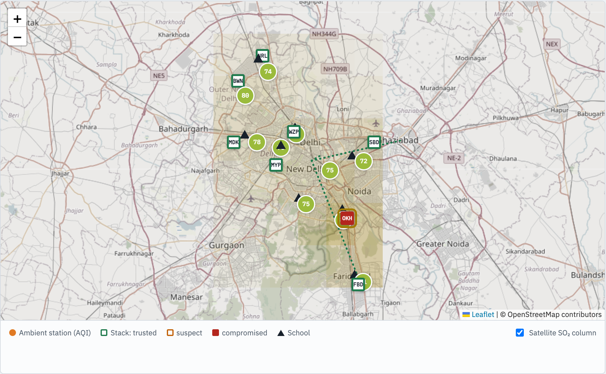

- **Circles** are ambient air-quality stations at real Delhi CAAQMS locations. The number is the station's AQI.
- **Squares** are factory stacks: a green outline means trusted, orange suspect, and filled red compromised.
- **Triangles** are schools.
- **Yellow shading** is the satellite SO₂ reading per grid cell. Darker means more SO₂ above that area.
- **Dotted lines** are quantum-key-distribution links between pollution boards (more on these later). They're green when secure and red under attack.

### The stack ledger

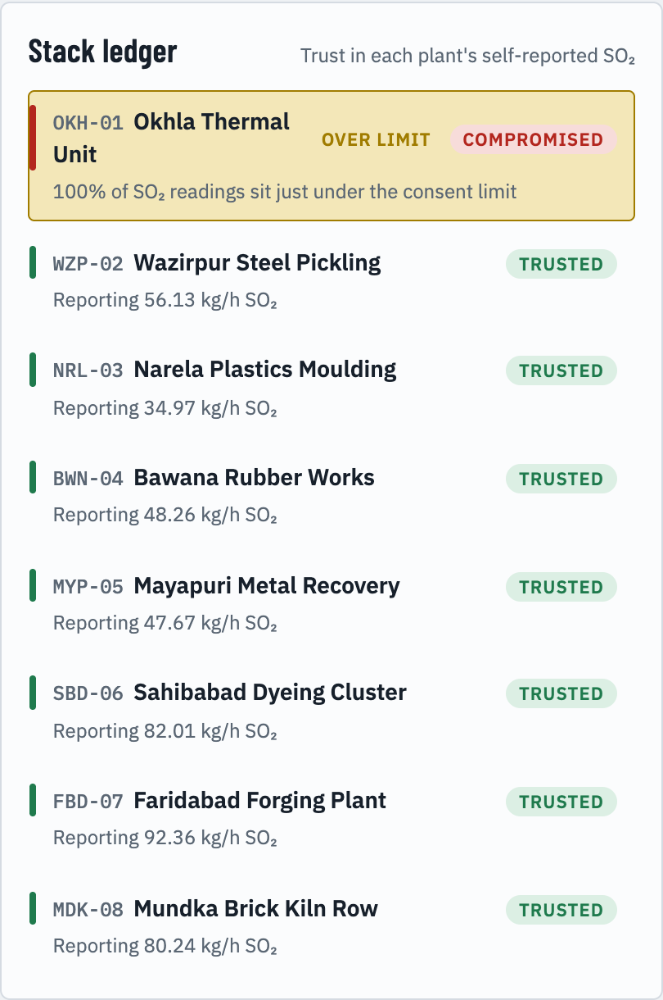

The ledger lists every factory, worst first, with its status and the main reason for it. Two tags matter, and they answer different questions:

- **Trusted, Suspect or Compromised** is about the *data*: can we believe what this plant reports?
- **Over limit** is about the *pollution*: is this plant emitting more than its consent allows?

A plant can be honest and over its limit, or dishonest and under it. Regulators need to know which.

### Stack detail

Clicking a stack opens its evidence trail:

- **The chart:**
  - **Black line:** what the plant reported. Only verified packets are plotted.
  - **Dashed gold line:** what the plant *must* have emitted, according to the stations and satellite.
  - **Red dotted line:** the consent limit.
  - **Tick marks along the bottom:** rejected or missing packets.
- **On the right:** trust score, reported vs. inferred emissions, an anomaly score, and every reason the plant was flagged.
- **Two demo controls:**
  - **Operator behaviour** switches the plant between honest and the cheating modes.
  - **Send a false SO₂ reading** injects a fake value, either *into the analyser* (before the chip signs it) or *in transit* (after signing).

The other panels cover school advisories, the QKD backbone and an event log. Each is covered below.

---

## How does TrueAir detect tampered emissions data?

TrueAir combines four kinds of evidence into one trust score, cheapest first. The full logic lives in [`integrity.py`](https://github.com/ANI-MAZING/True-Air/blob/main/backend/app/integrity.py).

### Layer 1: Signed readings catch edits and replays instantly

Each monitor has a **secure element**: a tamper-resistant chip holding an Ed25519 private key that the operator can't extract. The chip signs every reading together with a **counter that only goes up** and a **timestamp** ([`sensors.py`](https://github.com/ANI-MAZING/True-Air/blob/main/backend/app/sensors.py)):

```python
body = {"stack_id": "SBD-06", "ts": "2026-10-11T20:45:00+05:30",
        "so2": 81.4, "nox": 50.2, "pm": 35.1, "load": 0.98, "seq": 1043}
signature = secure_element.sign(canonical_json(body))
```

The regulator's server checks each packet:

| Check | Fails when | Status |
|---|---|---|
| Ed25519 signature | Any field changed after signing | `bad_signature` |
| Counter strictly increasing | An old packet is re-sent | `replay` |
| Timestamp matches the current slot | A recording is played back late | `replay` |
| Packet arrived at all | The uplink "goes offline" | `missing` |

This layer is exact and immediate. To test it, I rewrote an honest plant's reading to 5 kg/h in transit:

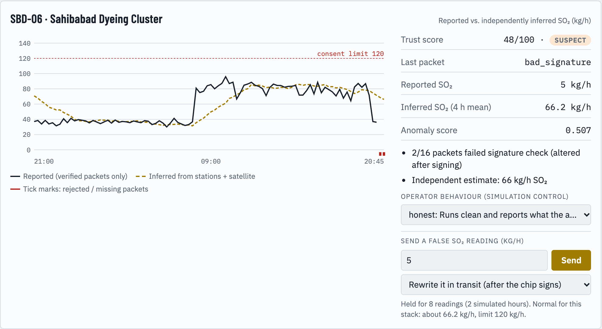
*Sahibabad, an honest plant, after a fake 5 kg/h was written into its packets in transit. The last packet's status is `bad_signature` and the rejected packets show as red ticks. The plant dropped to Suspect on the first reading and reached Compromised as more forged packets failed.*

Signatures have one blind spot. If the operator feeds a fake value *into* the analyser, the chip signs it faithfully. The next layers handle that case.

### Layer 2: Physics checks catch fakes that don't behave like instruments

Real instruments have habits that fakes rarely copy:

- **Flatlines.** A real SO₂ analyser has a few percent of noise. If readings vary by less than 1% over four hours, it almost certainly isn't a working analyser.
- **Capping.** If more than 40% of readings sit in a narrow band between 85% and 96% of the consent limit, the plant is very likely clipping its data.
- **Gaps.** When more than 20% of readings are missing, trust drops in proportion to how much is missing.

### Layer 3: The air itself shows what each stack emitted

This is the core idea. Stack monitors measure the chimney. Ambient stations and satellites measure the air, and the factory controls neither. If you know the wind, you can link the two.


**Forward model.** For each stack and each receptor (a station or a satellite grid cell), a dispersion model gives the concentration at that receptor from 1 kg/h at the stack, for the current wind ([`dispersion.py`](https://github.com/ANI-MAZING/True-Air/blob/main/backend/app/dispersion.py)):

- **Stations** use a steady-state **Gaussian plume**. Concentration falls with downwind distance, spreads sideways, and is zero upwind. The spread uses Briggs' urban dispersion coefficients.
- **The satellite** uses a wide Gaussian kernel shifted slightly downwind, because a column measurement smears a point source over many kilometres.

These weights form a matrix **W** for each 15-minute step:

```
station readings   = W_stations  · e  +  station background(t)  +  noise
satellite readings = W_satellite · e  +  satellite background(t) +  noise
```

In these equations, **e** is the vector of true emission rates. That's what we want to know.

**Inverse model.** TrueAir solves the equation backwards over a rolling four-hour window: 16 steps, each with 10 stations and 36 satellite cells. It uses SciPy's [non-negative least squares](https://docs.scipy.org/doc/scipy/reference/generated/scipy.optimize.nnls.html) to estimate:

- one average emission rate per stack, and
- one background level per time step (regional pollution that isn't from these stacks).

It works because the wind shifts during the window. Each stack shows up at different receptors at different times, which separates their contributions. Satellite rows get less weight because they're noisier, and a small penalty keeps stacks that are never downwind of anything from drifting.

**Comparison.** The estimate is compared with what the plant reported over the same window:

| Finding | Rule |
|---|---|
| Under-reporting | Reported is less than 70% of the air estimate |
| False or faulty high readings | Reported is more than 160% of the air estimate |
| Hiding a violation | Air estimate is more than 10% over the limit while reports stay under it |

A mismatch only counts when the gap is also large in kg/h, more than 20% of the limit. Estimates for small, weakly observed stacks are noisy, and this rule is what took false alarms on honest plants to zero.

Okhla, the plant that caps its data, shows the method at work:

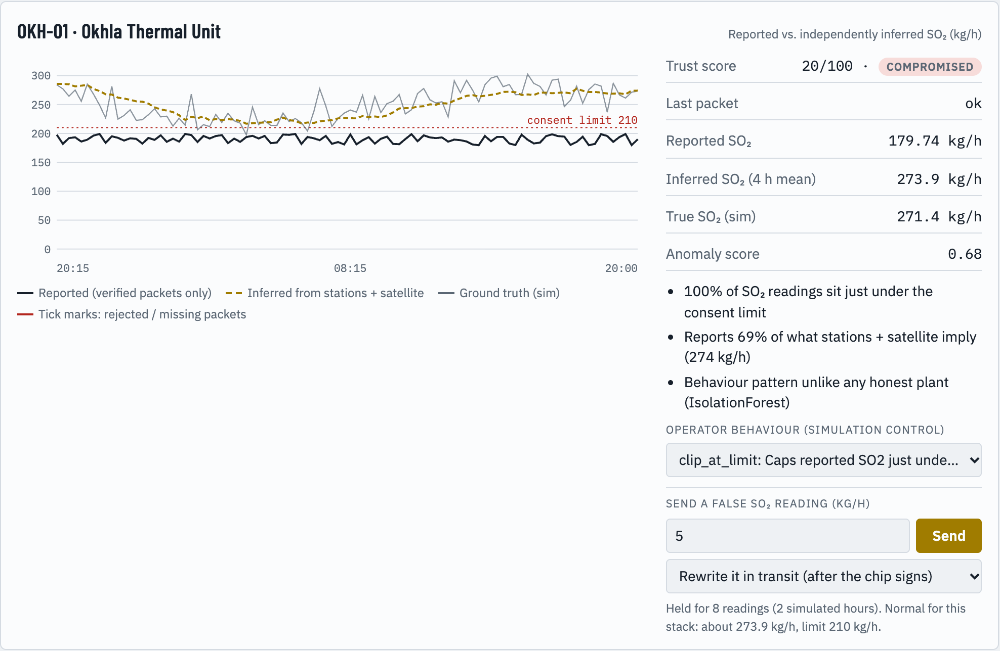
*Okhla reports about 180 to 195 kg/h, a steady line just under its 210 kg/h limit. The stations and satellite say it's emitting about 274 kg/h. With ground truth switched on, the grey line confirms the real value was about 271. TrueAir flags it Compromised and Over limit for three independent reasons.*

The harder case is a fake value fed **into the analyser**, where every packet is validly signed:

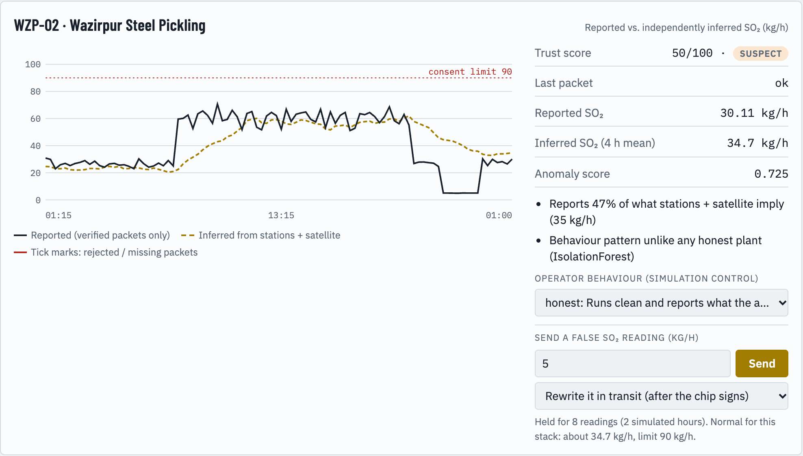
*Wazirpur, an honest plant, with a fake 5 kg/h fed into its analyser for two simulated hours (the flat section near the right). Every signature checks out. But the plant now "reports 47% of what stations + satellite imply", and the anomaly detector agrees, so it's flagged Suspect within a few readings.*

### Layer 4: A learned baseline flags anything that doesn't look honest

An [IsolationForest](https://scikit-learn.org/stable/modules/generated/sklearn.ensemble.IsolationForest.html) looks at five features of each plant's four-hour window:

- how much its readings vary,
- the share of readings in the capping band,
- the share of readings missing,
- the ratio of reported to inferred emissions,
- how steady emissions are relative to production load.

It's trained **only on honest plants**, from a separate simulation where nobody cheats. It never sees an example of tampering. It just learns what normal looks like and flags what isn't.

### How the trust score combines the evidence

Each layer subtracts from a score of 100:

| Evidence | Penalty |
|---|---|
| Packets failing the signature check | 40 to 70, depending on how many |
| Replayed packets | 40 to 70 |
| Missing data | up to 70, in proportion to the gap |
| Flatline | 35 |
| Capping pattern | 30 |
| Air estimate disagrees (too low or too high) | 35 |
| Over limit by air estimate, reports under it | 30 |
| IsolationForest anomaly | 15 |

**75 or above is Trusted, 40 to 74 is Suspect, and below 40 is Compromised.**

Trust drops at once but recovers by only 2 points per reading, about 8 per simulated hour. Without that, a plant that cheats only on high-emission days would look clean again by the next quiet night.

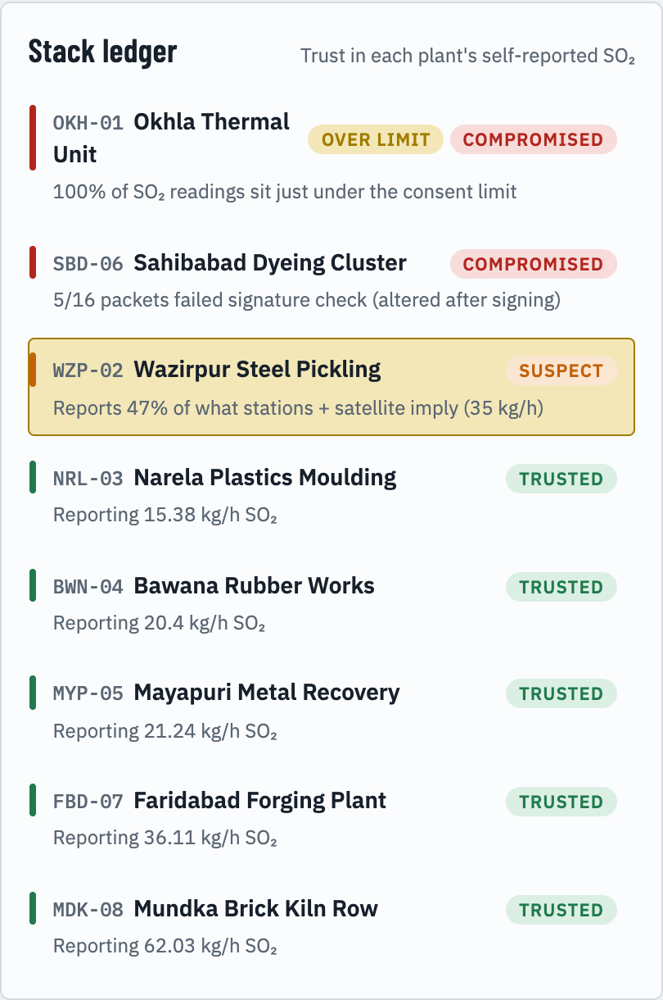
*The ledger after both experiments. The in-transit forgery (Sahibabad) is Compromised, the analyser forgery (Wazirpur) is Suspect, and the five honest plants are untouched.*

---

## How accurate is it?


These numbers come from TrueAir's simulated city, so they describe the method under known conditions, not a field trial.

**Methodology:** I ran the full engine for 6 random seeds × 100 steps, ignoring the first 20 steps of warm-up. For detection timing, I switched one clean plant to each cheating behaviour and counted the steps until it was no longer "trusted" (4 seeds per behaviour). The script [`scripts/evaluate.py`](https://github.com/ANI-MAZING/True-Air/blob/main/scripts/evaluate.py) reproduces every number in this section, and the unit tests check a smaller version of them on each run.

**Results:**
- **Zero false alarms** on honest plants across 3,360 stack checks.
- **City AQI stayed between 51 and 79** (Satisfactory) on normal days, with no school alerts.
- **Every cheating behaviour was caught within 105 simulated minutes.** Edits and replays were caught within 15.

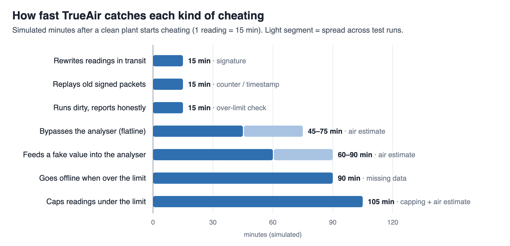

| What the operator does | Caught after | Caught by |
|---|---|---|
| Rewrites readings in transit | 15 min | Signature |
| Replays old signed packets | 15 min | Counter and timestamp |
| Runs dirty but reports honestly | 15 min | Over-limit check (data stays trusted) |
| Bypasses the analyser (flatline) | 45 to 75 min | Air estimate |
| Feeds a fake value into the analyser | 60 to 90 min | Air estimate |
| Goes offline when over the limit | 90 min | Missing data |
| Caps readings under the limit | 105 min | Capping pattern and air estimate |

The inverse model's estimates had a **median error of 9%** against true emissions (mean 18%, pulled up by small stacks the stations rarely see). Part of that gap is by design: the estimate is a four-hour average, compared with the true value at that moment.

---

## How does TrueAir protect schools on bad-air days?

Catching a cheat only matters if it changes what happens on a bad day. For each school, TrueAir does four things ([`alerts.py`](https://github.com/ANI-MAZING/True-Air/blob/main/backend/app/alerts.py)):

1. **Computes AQI** at each station using the CPCB National AQI method. Each pollutant (PM2.5, PM10, NO₂, SO₂) gets a sub-index, and the highest one is the AQI. The index and its bands are CPCB's; this [Indian Economic Service explainer](https://ies.gov.in/arthapedia/concept/national-air-quality-index) summarises them.
2. **Estimates the school's AQI** from its three nearest stations, weighted by inverse distance squared.
3. **Picks one action for the day.** The bands follow CPCB's AQI categories. The top band borrows from Delhi's Graded Response Action Plan, whose later stages have moved younger students to hybrid or online classes ([CAQM GRAP order, December 2024](https://caqm.nic.in/WriteReadData/LINKS/GRAP%20Order%20dt%2024122024a0df5515-d5a4-4cd9-a34f-9f84a3427af3.pdf)).

   | School AQI | Advisory |
   |---|---|
   | up to 100 | Normal day |
   | 101 to 200 | Children with asthma skip strenuous PE |
   | 201 to 300 | Move PE and assembly indoors, and keep windows shut at peak traffic |
   | 301 to 400 | No outdoor activity, run air purifiers, notify parents of children with asthma |
   | above 400 | Consider hybrid classes for primary grades |

4. **Names the main industrial source upwind** of the school, using the same plume model. If that plant isn't trusted, TrueAir uses its *air-based* emission estimate instead of its report, and says so.

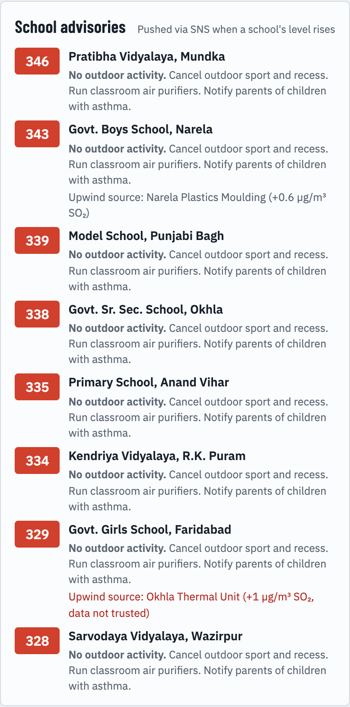
*On a smog day, every school moves to "No outdoor activity". For the girls' school in Faridabad, the main upwind source is Okhla Thermal Unit, shown in red because its data isn't trusted.*

When a school reaches "No outdoor activity" or worse, an alert is queued for Amazon SNS.

---

## Where does quantum computing fit?

I came into this hackathon with earlier research on quantum key distribution (QKD) and quantum machine learning, and I wanted to use it. Working out where it actually helps shaped the design.

**QKD can't stop tampering at the source.** If a reading is faked before it's encrypted, QKD delivers the fake value perfectly securely. That's why the integrity engine is entirely classical.

**QKD does fit the regulator's backbone.** The links between the central and state boards carry data from many plants at once, which makes them high-value targets. TrueAir simulates **BB84** sessions on three such links. It reuses the attack simulator from my earlier research: normal operation plus seven attacks, including intercept-resend, photon-number splitting, detector blinding and a combined attack. Each session produces nine metrics, such as the quantum bit error rate (QBER), key length and photon timing, and a random-forest classifier labels the session.

BB84 is considered secure while QBER stays below about 11%, the bound from Shor and Preskill's proof ([arXiv quant-ph/0003004](https://arxiv.org/abs/quant-ph/0003004)).

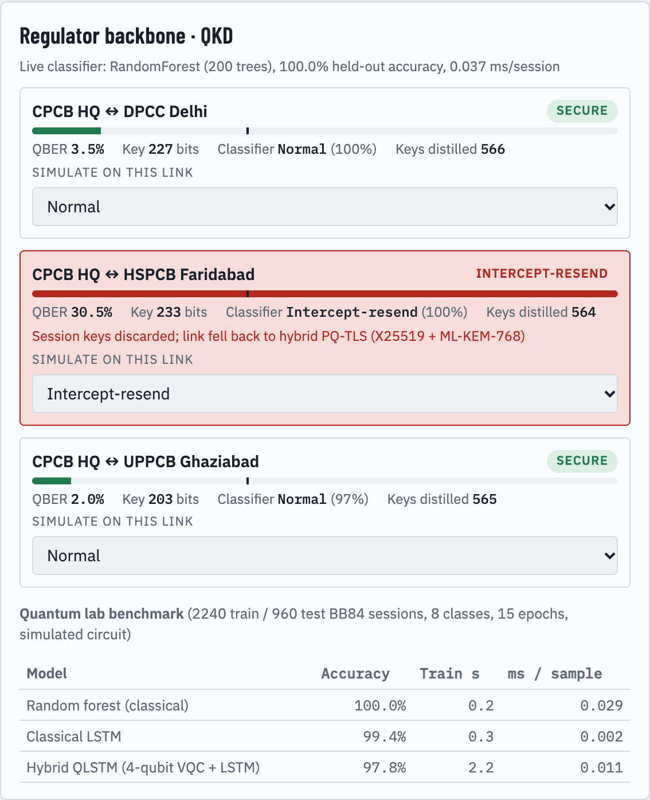
*Under an intercept-resend attack on the Faridabad link, QBER jumps to about 30%, far past the 11% bound. The classifier names the attack, the session keys are thrown away, and the dashboard switches the link to its fallback: hybrid post-quantum TLS (X25519 plus ML-KEM-768). In the demo this fallback is simulated, not a real TLS handshake. ML-KEM is the key-encapsulation standard NIST published as [FIPS 203](https://doi.org/10.6028/NIST.FIPS.203) in August 2024.*


**The quantum ML result was a little humbling.** While porting my earlier hybrid quantum LSTM, I found a bug in my own notebook. Wrapping the circuit output in `torch.tensor(...)` cut it off from the computation graph, so the quantum weights never trained. With `torch.stack` instead, the hybrid model does learn ([`qlstm_benchmark.py`](https://github.com/ANI-MAZING/True-Air/blob/main/scripts/qlstm_benchmark.py)).

On a stratified held-out test set of 960 BB84 sessions:

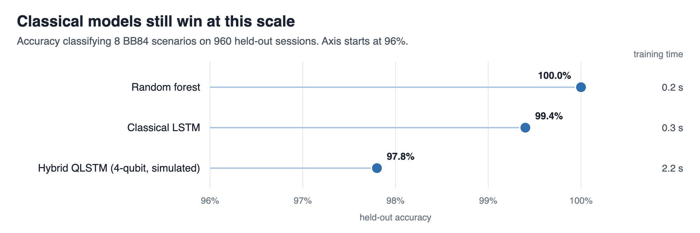

| Model | Accuracy | Training time |
|---|---|---|
| Random forest | 100.0% | 0.2 s |
| Classical LSTM | 99.4% | 0.3 s |
| Hybrid QLSTM (4-qubit circuit + LSTM, simulated) | 97.8% | 2.2 s |

At this scale, classical models win, and the dashboard shows that table as it is.

---

## How is TrueAir built on AWS?

```
            Browser: Leaflet + vanilla JS dashboard
                          │  HTTPS
                          ▼
   ┌────────────── AWS App Runner (ap-south-1) ──────────────┐
   │  Container image pulled from Amazon ECR                  │
   │  FastAPI + simulation and integrity engine               │
   │   ├─ world simulator (wind, loads, stations, satellite)  │
   │   ├─ integrity engine (Ed25519, SciPy NNLS, sklearn)     │
   │   ├─ school advisories                                   │
   │   └─ QKD link monitor                                    │
   └──────┬───────────────────────────────┬───────────────────┘
          ▼                               ▼
   Amazon DynamoDB                  Amazon SNS
   every verdict, violation,        throttled alert digests
   advisory and QKD alert           (email subscribers)

   AWS CloudFormation: one template creates the table, topic, IAM roles and App Runner service
   AWS Budgets: spend alarm on the account
```

**What each service does:**

- **Amazon ECR** stores the Docker image. The deploy script builds it for `linux/amd64`, tags it with a timestamp and pushes it.
- **[AWS App Runner](https://docs.aws.amazon.com/apprunner/latest/dg/what-is-apprunner.html)** runs the container with HTTPS and health checks on `/api/health`, with no servers or load balancers to manage. The simulation keeps its state in memory, so the service is pinned to exactly one instance (1 vCPU, 2 GB).
- **[Amazon DynamoDB](https://docs.aws.amazon.com/amazondynamodb/latest/developerguide/Introduction.html)** stores every event in on-demand mode: status changes, limit violations, school escalations and QKD attacks. The partition key is `kind#subject` (for example `stack#OKH-01`) and the sort key is the timestamp, so one query returns a plant's full history.
- **[Amazon SNS](https://docs.aws.amazon.com/sns/latest/dg/welcome.html)** emails alerts to subscribers. Alerts are **batched into one digest at most every 30 minutes**, holding the latest 15 events. The lessons section explains why.
- **AWS CloudFormation** creates the table, topic, roles and App Runner service from [one template](https://github.com/ANI-MAZING/True-Air/blob/main/infra/template.yaml). That includes two **IAM** roles: one lets App Runner pull from ECR, and a least-privilege role lets the app write to this one table and publish to this one topic, nothing else. The deploy script creates the ECR repository.
- **AWS Budgets** (set up separately in the console) sends an alarm if spending crosses a small monthly limit. The service costs roughly $2 a day while it's running, and it can be paused between demos.

The dashboard's event log shows the same events that land in DynamoDB, and its header confirms where they're going:

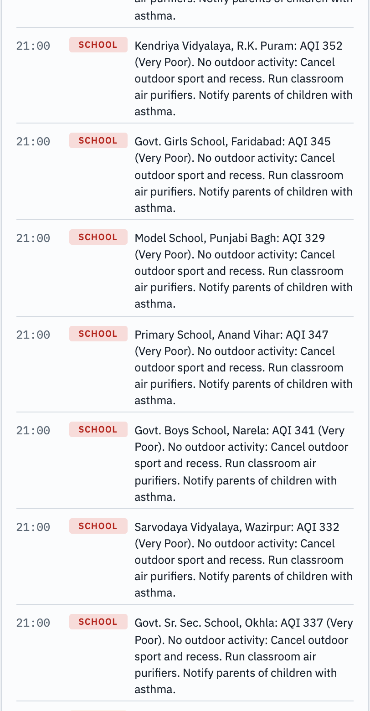
*Newest first: a QKD attack, the in-transit forgery caught by its signature, the demo console's record of the injection, and Okhla marked compromised because the air estimate (264 kg/h) is over its limit while its reports stay under it. Each line is also an item in DynamoDB.*


**Tech stack:**
- **Backend:** Python 3.12, FastAPI, NumPy, SciPy and scikit-learn.
- **Signatures:** the `cryptography` library (Ed25519).
- **Quantum lab:** PennyLane and PyTorch.
- **Dashboard:** Leaflet for the map, plain JavaScript.
- **Deployment:** Docker, plus boto3 for DynamoDB and SNS.

---

## How would a pollution control board use TrueAir?

TrueAir is designed to sit next to a board's existing CEMS data server.

1. **Inspectors** open the stack ledger each morning and get a ranked list of plants whose data doesn't add up, with evidence like "reports 69% of what the air implies". Surprise inspections go there first, instead of following a fixed rota.
2. **Regulators** get a timestamped evidence trail (signature failures, replays, gaps, air mismatches) stored in DynamoDB to support a notice.
3. **Schools and district education officers** subscribe to alerts. They get one clear action for the day and the name of the plant upwind.
4. **Citizens and journalists** could get a public, read-only view of which plants' data can be trusted.

**What's simulated today, and what a real deployment needs.** All readings in the demo are synthetic. The station locations are real, but the stacks and schools are fictional. Going live would need:

- real CEMS feeds from the boards,
- signing inside the analyser, done by the vendor or with a hardware secure element,
- live CPCB station data,
- Sentinel-5P satellite data, which is free on the [Registry of Open Data on AWS](https://registry.opendata.aws/sentinel5p/),
- IMD weather for the dispersion model.

Accuracy would drop in the real world. Wind data is coarser, Sentinel-5P passes overhead about once a day and is noisy for SO₂, and plants packed close together are hard to tell apart. The signature and replay checks stay exact anyway. The air-based check should stay strongest for the largest single sources and for industrial clusters.

---

## What I learned building TrueAir

**Organisation policies beat IAM.** My first two AWS accounts belonged to AWS Organizations whose [service control policies](https://docs.aws.amazon.com/organizations/latest/userguide/orgs_manage_policies_scps.html) blocked almost every service. Adding `AdministratorAccess` changed nothing. The giveaway was in the error text: *"with an explicit deny in a service control policy"*. The fix was deploying from an account whose organisation I controlled.

**Alert systems need throttling from day one.** My first deploy emailed me every time any school's level rose, in a simulation where a day passes every three minutes. My inbox filled up within minutes. Now alerts go out as one digest at most every 30 minutes, and schools only trigger an email at "No outdoor activity" or worse.

**A realistic baseline matters as much as detection.** My first version had most plants over their limits, so everything was red and nothing stood out. Making the default world honest and compliant, and modelling cheating as "run dirty, then hide it", made every alert meaningful.

**Benchmark your own work honestly.** Finding a training bug in my own quantum model was humbling. A real result, even an unexciting one, is worth more than a claimed quantum advantage.

---

## Frequently asked questions

**Is TrueAir using real pollution data?**
Not yet. Every reading is simulated, so the detection numbers above are under controlled conditions. The station locations are real Delhi CAAQMS sites. The next step is connecting live CPCB station data and Sentinel-5P satellite data.

**Can a factory beat it?**
Edits after signing and replays can't get past the signature and counter checks. The air-based check is harder to fool but not impossible. It's weaker for small plants and for plants packed close together, where the stations can't tell their plumes apart. That's why TrueAir combines four layers instead of relying on one.

**Does the quantum part make detection more accurate?**
No. The integrity engine is fully classical. QKD protects the links between pollution boards, and in my benchmark the hybrid quantum model was slightly *less* accurate than the classical models.

**What does it cost to run on AWS?**
Roughly $2 a day while the App Runner service is active. DynamoDB and SNS cost cents at this scale. Pausing the service between demos cuts the cost further.

**Can I run it myself?**
Yes. The [README](https://github.com/ANI-MAZING/True-Air#readme) covers running it locally with one command, and deploying to your own AWS account with the included script and CloudFormation template.

---

## What's next for TrueAir

- **Real data:** swap the simulator modules for live CPCB station data, Sentinel-5P and IMD weather. The integrity engine doesn't need to change.
- **Forecasting:** predict bad-air hours in advance, so schools hear the evening before instead of on the day.
- **Amazon Bedrock:** write school advisories in Hindi and English.
- **Access control:** separate read-only views for schools and the public, and full access for regulators.

If you work on air quality, emissions monitoring or environmental data in India, I'd love to hear from you.

---

*About the author: Aniruddha Gharat builds at the intersection of quantum communication, machine learning and cloud systems. His earlier research on hybrid quantum-classical LSTMs for detecting QKD attacks is on [GitHub](https://github.com/ANI-MAZING/Hybrid-Quantum-Classical-LSTM-for-Quantum-Key-Distribution). TrueAir was built for an AWS sustainability hackathon (Air track). You can reach him through [GitHub](https://github.com/ANI-MAZING).*
